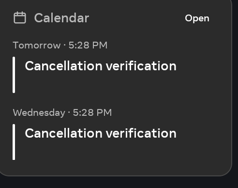
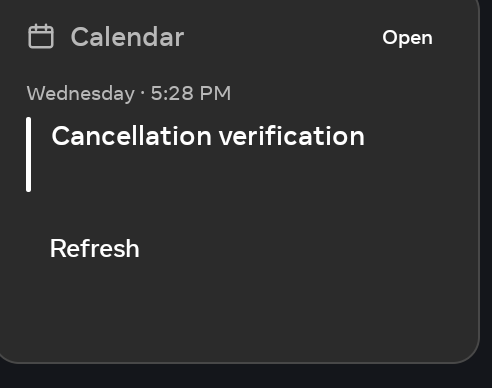

# Calendar cancellation lists — 3 November 2026

Optimized **1.89/code83** is installed in Family Area and Living Area. Recurring
calendar events now honour every date in a comma-separated `EXDATE` property.
Previously only the first exclusion was read, so later cancelled appointments
could reappear on Home.

The parser splits the list at the property boundary and passes each value to the
existing date parser with its original parameters. UTC, `TZID`, floating and
all-day handling remain shared. Repeated properties combine their exclusions.
The recurrence count still counts generated occurrences before exclusions; removed
appointments do not extend `COUNT`.

## Verification

| Check | Result |
|---|---|
| New real-parser regression cases against the original source | 9 cases, 6 failures, 0 errors |
| Same cases after the fix | 9 passed |
| Full JVM gate | 4,000 passed, 418 suites, 0 failures/errors/skips |
| Debug and optimized builds | Passed; R8 and vital lint passed; combined run 127 seconds |
| Independent static review | No actionable findings; no independent runtime claim |
| Installed Family baseline, generated daily calendar | Two appointments appeared despite two of the three dates being excluded |
| Installed Family candidate, same generated calendar | Only the third date remained, correct in both Calendar and Today |
| Restore original calendar and return through native Settings | Complete profile matched; Calendar returned to its original empty state |
| Both rooms | Deployment helper read back the complete installed APK and matched its SHA-256; served identity is 1.89/code83 |
| Preservation | Complete settings, layout, sources and screensaver configuration match each room's baseline; names and dev mode unchanged |
| Family runtime | Font and enabled accessibility services unchanged; Chrome task retained; normal photo frame foreground and visually checked |

The nine new cases cover UTC lists including the initial occurrence, all-day dates,
fixed `TZID`, floating dates, repeated properties, folded lines, malformed tokens
between valid values, and no/single-exclusion controls.

## Artifact and boundaries

Package: `com.immortal.launcher.debug`. APK bytes: **25,861,122**.
SHA-256: `8b1e080bb9a9f5653f4bd4f30bf5cfd2ae81bffd2af9deb29e4d188216d3dd0c`.
The verified signer matches the previous 1.88 rollback artifact.

The controlled feed was served on an owned loopback port through a temporary
Family wireless-ADB reverse mapping. Original configuration was restored through
the declarative registry. The server and mapping were removed; temporary token
registry copies were removed and both workers closed. No owner calendar account,
Home Assistant, GitHub authentication or publication was involved. A direct shell
start of the non-exported Settings activity was rejected; the actual Home gear and
Android Back provided the successful restoration path.

Native acceptance covers one generated UTC recurrence on Family's Android 10
hardware. Other formats have JVM coverage. Living received the exact accepted
artifact and preservation checks; its calendar UI was not exercised. No FPS,
latency improvement, broader recurrence/DST support or whole-product acceptance
is claimed. Processing is linear in exclusion count during feed preparation,
outside UI rendering; there is no new polling or network path.

This unit retains its original **00:23:57–00:53:57 UTC** deadline, including
cleanup and commit. Weather approval remains recorded, but its separate native
layout acceptance stays held under its original issue limit. Other exhausted
issues remain parked.

Structured receipt:
`mocks/portal-widget-gallery-20261102/evidence/calendar-exdate-verification.json`.
