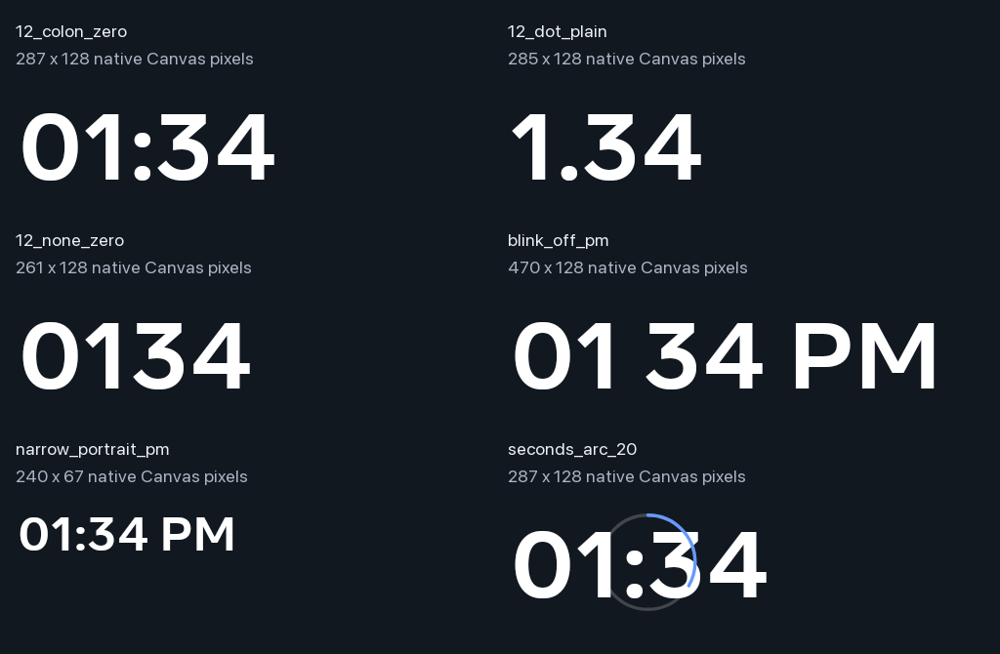

# Canvas clock format settings — Family Area

The shipped Canvas digital clock now honors the existing `ClockSpec` choices:
leading zero, colon/dot/no separator/blinking separator, and optional AM/PM.
Previously its cached formatter always used `HH:mm` or `hh:mm`, ignoring these
choices. For example, disabling the leading zero now displays `1:34` instead of
`01:34`; enabling AM/PM displays the appropriate suffix.

There are no new settings or persistence fields. Existing 12/24-hour, locale,
timezone, daylight-saving and accessibility behavior remain covered. Seconds
retain their existing arc representation.

Branch: `codex/slideshow-style-matrix-20261101`. Family Area has the optimized,
non-debuggable APK **28494a67…**, signed with the existing certificate.
Living Area was untouched.

## Work and rendering cost

The small `DigitalClockTimeFormat` helper resolves the cached formatter's
pattern from the existing spec. The formatter is rebuilt only when the locale
changes. Width reservation includes localized digits and both localized
meridiem labels, keeping the measured dimensions stable.

The update gate still suppresses invalidation when the displayed minute and
optional arc second have not changed. The regression for AM/PM confirms
**one invalidation across 60 ticks**, the same cached formatter, then one
additional invalidation when the minute changes. This is measured update
behavior in the JVM fixture, not a panel FPS result.

## Verification

| Check | Result |
| --- | --- |
| Focused regression before the fix | **6 failures / 14 tests** |
| Full freshly executed Android unit gate | **3,743 tests / 392 suites**, zero failures, errors or skips |
| Debug, optimized and Android test APK builds | Passed |
| Actual Android 10 Canvas probe | **133/133 checks**, 24 literal format cases |
| Native generated Canvas renders | **6/6**, including a 240-pixel narrow parent |
| Blink accessibility and measured dimensions | Passed |
| Seconds remain an arc and change with the second | Passed |
| Read-only review | No concrete blockers found |

The native probe constructs the actual `PrimeDigitalClockFaceView` on the
Portal's main thread, supplies fixed times, measures and lays it out, and draws
it into an Android bitmap. It compares literal displayed/accessibility text,
checks glyph presence and margins, and compares generated text pixels.
It does not launch an Activity or alter the device's locale/timezone.

These are **detached native Canvas renders**, not screenshots of the
screensaver or measurements of the display panel. The montage adds a dark
matte and labels around the original, unscaled generated bitmaps.

The first full build attempt failed because the Mac ran out of disk space.
That attempt is retained privately and is not counted as a passing gate.
Identical, agent-created APK backups were converted to independent APFS
copy-on-write clones, preserving all paths and contents and recovering about
1.9 GB. The subsequent full gate and all three builds passed.

## Deployment and restoration

The original app and test APKs were saved privately. The owned Dream was
retired before installation, and only Immortal's accessibility services were
temporarily detached. The final optimized app and original test APK are
installed. All **97 settings**, photo sources, persistent pin, accessibility
list, font scale and brightness policy match the saved baseline. The Android
system process is unchanged; the original Dream is restored.

No instrumentation or performance collector remains active. Generated probe
files have been removed and their absence checked through the running app.
Private media, credentials, configuration snapshots and rollback APKs remain
outside Git.

The original issue slot started at **13:06:04 UTC** on November 1, with a hard
deadline of **13:36:04**. Native verification and restoration, including owned
file cleanup, completed in **12 minutes 33 seconds**, without resetting the cap.

This delivery fixes format correctness. It does not change the clock's font,
arc styling, sensor thresholds or brightness transition. Physical fade
smoothness and optical comfort remain pending because the user is unavailable
to test them. No repeat physical check was requested.

[Native checks](../mocks/portal-premium-player-20261030/evidence/native-clock-format/checks.json)
and [sanitized deployment receipt](../mocks/portal-premium-player-20261030/evidence/native-clock-format/verification.json).
