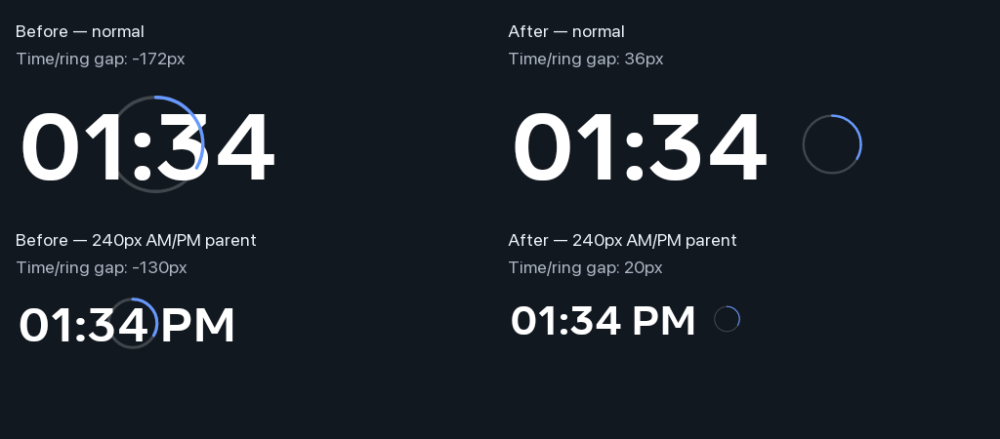

# A separate seconds indicator — Family Area

The optional Canvas clock seconds ring now sits beside the time instead of
painting over its digits. The previous layout reserved only text width and
drew a circle around the center of that text rectangle.

The existing `ClockSpec.showSeconds` option controls the indicator. No setting,
preference, Activity, view, timer, animation or formatter was added. When seconds
are off, five generated native fixtures retain **identical Canvas pixels**.

Branch: `codex/slideshow-style-matrix-20261101`. Family Area has optimized,
non-debuggable APK **e589298d…**, signed with the existing certificate.
Living Area was untouched.

## Layout and cost

The measure pass reserves the existing time width plus a trailing slot. The
ring's outer diameter is 64% of the text size, with an 18% gap after the time
reservation. Its full stroke fits inside that diameter. The ring position uses
the stable digit/meridiem reservation, preventing movement as the time changes.

When a parent is narrow, the complete time-and-indicator layout scales together
to fit. With ample space, the time keeps its nominal font size and height.
The existing size families remain proportional and distinct on portrait
layouts. The seconds-off measure and draw calculations retain their original
behavior.

Drawing uses the existing paints and cached primitive width measurement. The
new placement adds primitive arithmetic, not per-draw objects or font
measurement. The existing minute/second invalidation gates and tick schedule
remain unchanged. This describes the implementation and regression coverage;
no panel FPS or optical smoothness measurement is claimed.

## Native before and after

The actual Android 10 Portal rendered the real clock view into generated
Canvas bitmaps at fixed times. The probe separately hides the ring paints or
time paint to measure the full indicator and glyph bounds, restores the
paints, and checks the next second.

| Native fixture | Old ring/text gap | New ring/text gap | Second 20 → 21 |
| --- | ---: | ---: | --- |
| Normal clock | **−172 px** | **36 px** | Only indicator pixels change |
| AM/PM, 240-pixel parent | **−130 px** | **20 px** | Only indicator pixels change |

Negative gaps indicate that the ring begins before the time's right edge.
The normal fixture also recovers the text pixels previously covered by the
indicator: its classified white glyph count changes from **7,047 to 7,208**.

These are **detached native Canvas renders**, not live screensaver screenshots
or a browser mock. The montage adds labels and a dark matte; generated clock
bitmaps are unscaled.

## Tests, failures and restoration

The geometry regression initially fails **3 of 11 tests** on the old
reservation. All **11 pass** after the correction. It covers independent
text/indicator space, tight parents, nominal size, portrait size families,
empty parents, extreme custom scale and unchanged seconds-off geometry.

The native old renderer fails **9 of 156 checks**, with no isolated exception:
eight indicator/text separation checks and one pixel-change isolation check.
That negative run and its generated images are retained. After the fix,
**156/156 checks pass**, across **24 literal cases and seven renders**.
The probe also verifies accessibility, fixed measured dimensions, text
stability and changes restricted to indicator pixels across consecutive
seconds. All five seconds-off before/after renders are pixel-identical.

The freshly executed full gate passes **3,748 Android unit tests / 392 suites**,
with no failures, errors or skips. Debug, optimized and Android test APK builds
pass. A read-only review found no concrete blockers.

The old native run restores its baseline before the next install. After final
validation, the optimized app and original test APK are installed. All
**97 settings**, photo sources, persistent pin, accessibility list, font scale
and brightness policy match their saved values. The Android system process
is unchanged and the original Dream is restored. No instrumentation or
performance collector remains active. Generated device files are removed;
their absence was checked through the running app.

The original 30-minute slot started at **13:20:05 UTC** on November 1, with a
hard deadline of **13:50:05**. Native verification, restoration, pixel
comparison and cleanup completed in **6 minutes 59 seconds**, without
resetting the cap.

This fixes the optional indicator's layout and preserves existing format
choices. The clock font, night sensor thresholds and brightness fade are
unchanged. Physical fade comfort remains pending because the user cannot test
it now. The broader goal remains incomplete.

[Before checks](../mocks/portal-premium-player-20261030/evidence/native-clock-seconds/before-checks.json),
[after checks](../mocks/portal-premium-player-20261030/evidence/native-clock-seconds/after-checks.json),
and [sanitized deployment receipt](../mocks/portal-premium-player-20261030/evidence/native-clock-seconds/verification.json).
