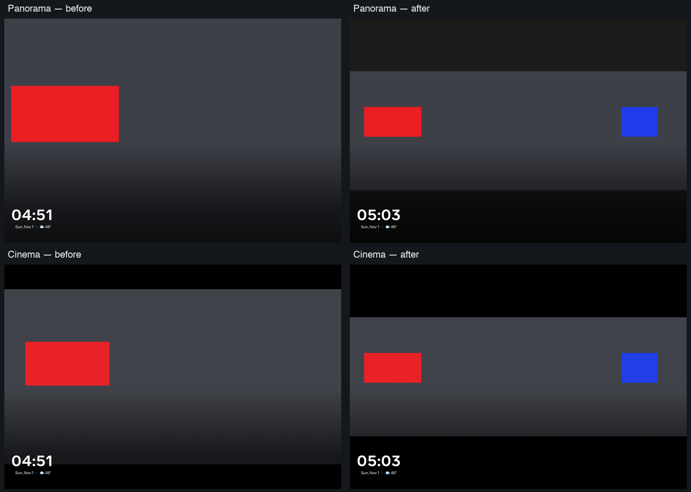

# Face-region framing — Family Area

**Delivered:** Panorama and Cinema retain the padded union of detected faces,
at the largest crop scale that fits that union. Previously, their static crop
centered one focal point and could hide another person completely.

Branch `codex/slideshow-style-matrix-20261101`. Optimized, non-debuggable APK
**0e37dcb1…** is installed on Family Area with the existing signing certificate.
Living Area was untouched.

The issue slot began **12:44:00 UTC** on November 1, with the original hard
deadline **13:14:00**. Initial native framing and restoration passed by
**12:58:49**. Review then identified two additional geometry/test edges.
The final build's native framing and restoration passed by **13:04:40**:
**20 minutes 40 seconds**, without resetting the cap.

## Behavior and cost

The existing face detector now caches the normalized union of trustworthy face
boxes alongside its focal point and people weight. The existing worker still
uses its original detector, 320-pixel decode target and cancellation gates.
There is no new detector, executor, animation loop or per-frame analysis.

The Kotlin JSON bridge and the actual JavaScript photo normalizer both retain
the optional `fb: [left, top, right, bottom]` field. The crop planner adds
padding equal to 10% of the union extent on each side of the cropped axis,
clipped at the photo edges. It chooses the largest admitted scale that fits this padded
region, then positions the original focal point as centrally as those bounds
permit. Both modes already keep face-protected photos static.

Cinema selects horizontal or vertical overflow using the cover constraints
directly, avoiding division-rounding mistakes. It reduces the photo extent
only when a spread group requires it and centers the photo within its existing
matte. Small groups can retain the
original immersive crop. Point-only photos and photos without valid bounds
retain their original layout; existing default-output hashes still pass.

Old weighted cache entries can be upgraded by a valid seven-field result.
Malformed seven-field entries can be repaired. Complete regions and existing
no-face entries resist late writers. A successful reanalysis that finds no
region preserves the old weighted point and suppresses repeated attempts for
that URL across handles **for the current process**; restart allows another
attempt. Decode/SDK failures retain their existing retry behavior.

Newly detected bounds enter the legacy engine's **next-start metadata snapshot**.
This does not add live reframing of a photo already displayed.

## Native result

The real Android 10/API 29 Portal+, **2160 × 1440, 180 dpi**, rendered a generated
2400 × 800 image with two solid, separated face-region markers. Its private
cache was temporarily seeded with the known focal point and union bounds.
These are actual `PhotoDreamService` pixels over wireless ADB, not a browser
mock or emulator.

| Actual Dream style | Second region before | Second region after | First region after |
| --- | ---: | ---: | ---: |
| Panorama | **0 pixels** | **43,739 pixels / 229 × 191** | **69,906 pixels / 366 × 191** |
| Cinema | **0 pixels** | **43,739 pixels / 229 × 191** | **69,906 pixels / 366 × 191** |

All four final marker rectangles have **100% classified pixel fill**. Their
dimensions match the calculated maximum crop scale within the checker's
two-pixel raster tolerance. The expected rendered source width is
**2292.994 pixels**; blindly containing the entire photo would produce a
smaller scale and fail the scale assertion.

## Failed integration attempt and regression coverage

The first candidate's native check **failed**: `photos.js` normalized away
`fb`, so both styles retained their old crop. That failure remains in
`normalizer-gap.json` and is not counted as a passing case.

The regression now feeds metadata through the actual Android photo normalizer
before executing the real mode code. Before the normalizer fix, **9 of 15**
focused tests failed; all **15 pass** afterward. Review added regressions for
vertical overflow on a 1920 × 1080 viewport and an axis-selection rounding edge.
Each new regression failed before its respective correction; all **17 focused
tests pass** now. The reused-scene check explicitly follows the incoming
scene through both layers. The full slideshow suite is
**296/296 passing**, covering group spread, image edges, preserved small-group
scale, motion preference, invalid/missing metadata and reused scene geometry.

The full Android unit gate freshly executed **3,737 tests / 392 suites**, with
zero failures, errors or skips. Debug and optimized builds passed. After the
assets-only normalizer correction, the unchanged Kotlin unit gate was
up-to-date; both Android artifacts were rebuilt successfully.

## Restoration and limits

The original **97 settings**, **22 source fields**, accessibility service list,
persistent pin, global font scale and brightness policy match their saved
values. The Android system process remained unchanged. Generated files and
their cache entry are removed, the original Dream is restored, and no
instrumentation or performance collector remains active. Private media,
credentials, settings snapshots and rollback APKs remain outside Git.

This verifies the cached-metadata-to-native-framing path in these two styles.
It does **not** measure detector recall across household albums, all slideshow
styles, animation smoothness, panel FPS or optical brightness comfort. The
alternate viewport is deterministic JavaScript geometry coverage, not a
second physical Portal test. The
user's natural-light clock/brightness check remains pending; no repeat
physical test was requested.

[Sanitized verification receipt](../mocks/portal-premium-player-20261030/evidence/family-face-region-framing/verification.json).
