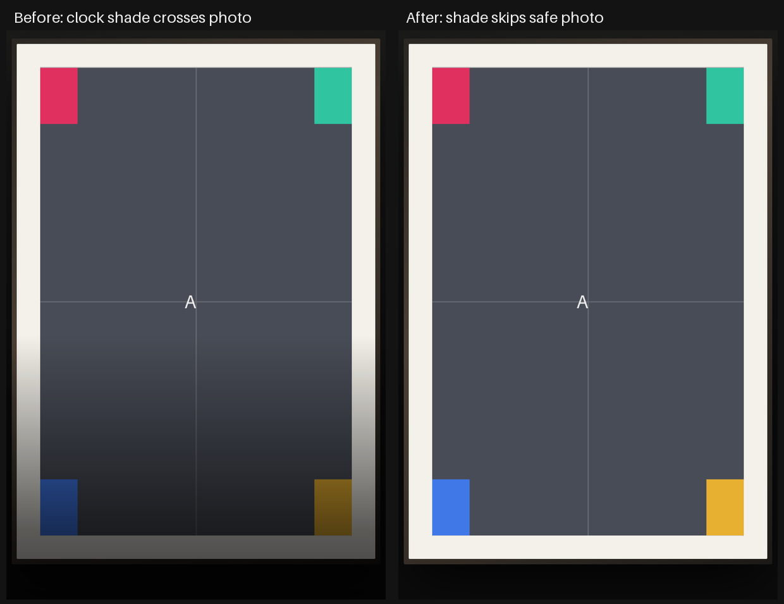

# Framed Print photo colors — Family Area

**Delivered:** Framed Print skips the clock's full-width shade when measured
overlays clear the photo and its pale mat. It retains contrast protection when
an overlay could overlap that area or its geometry is unknown.

Source **0160eb32**, branch `codex/slideshow-framed-native-20261101`.
Family Area has optimized, non-debuggable APK **625e9f5d…**, with the existing
signing certificate. Living Area was not changed.

The issue slot started **11:20:16 UTC** on November 1; its original deadline was
**11:50:16**. Final native checks and fresh device health were confirmed at
**11:34:24**, after **14 minutes 8 seconds**. The cap was not reset.

## Actual defect

The photo layer already contained the whole print. FaceRenderer then shaded
the lower 45% of the screen, altering the photo and its mat even when the small
clock occupied dark room space beside them.

Generated corner markers on the actual Portal exposed the loss:

| Lower-corner sample | Original RGB | Before | Delivered |
| --- | --- | --- | --- |
| Landscape blue | 64,120,232 | 36,67,129 | **64,120,232** |
| Landscape yellow | 232,176,48 | 129,98,27 | **232,176,48** |
| Portrait blue | 64,120,232 | 29,54,104 | **64,120,232** |
| Portrait yellow | 232,176,48 | 104,79,21 | **232,176,48** |

All eight sampled corner colors now match their generated source exactly.

## Safe, bounded correction

A blanket exemption was rejected during review: centered clocks and wide
now-playing cards can overlap Framed Print's pale mat or photo.

The guard reuses FaceRenderer's measured widget bounds, padded for shadows and
burn-in drift. A conservative centered envelope includes the fixed 56 CSS pixel
frame/mat, rounded photo dimensions and maximum 1.06 photo motion. If any measured
overlay touches that envelope, or a visible overlay has not been measured, the
existing shade remains.

One layout listener refreshes the decision after layout changes. It is removed
before rebuilding the overlay and when the renderer stops. The shade becomes
invisible only when the decision changes. This adds no polling timer, image
decode or settings read. It avoids drawing the gradient for the accepted safe
composition; **CPU/GPU/frame-time gains were not measured**.

Gallery's existing exemptions and other styles' shading remain intact.

## Validation

Family Area is the physical Android 10/API 29 Portal+, **2160 × 1440, 180 dpi**.
Wireless ADB supplied actual PhotoDreamService screenshots from the installed
optimized APK, without a debug preview, emulator, instrumentation or collector.
Photo motion was temporarily disabled to make the color/geometry comparison
deterministic.

| Native case | Measured print | Relative aspect error | Result |
| --- | ---: | ---: | --- |
| Landscape 1200 × 800 | **1296 × 864** | **0** | Four corners, original colors, complete bounded image |
| Portrait 800 × 1200 | **690 × 1035** | **0** | Four corners, original colors, complete bounded image |

**22/22 native image assertions** pass; the final run, including restoration,
took **11.121 seconds**. Visual inspection confirms the corner clock remains
readable on the dark room background. The centered-clock/wide-card fallback,
unknown geometry, bounded traversal, motion overflow and CSS rounding pass unit
tests; those alternate overlay configurations were not pixel-captured on-device.

`testDebugUnitTest`, `assembleDebug` and `assemblePerformance` pass:
**3,722 tests, 392 suites, zero failures/errors/skips**, final build **1m 25s**.
The updated native helper also passes Python syntax validation.

The final install took **17.720 seconds**. Fresh health confirms the exact APK
hash, non-debuggable build, all **97 settings** and **22 photo-source fields**,
pin/accessibility state, font scale and automatic-brightness policy. The original
Immortal Dream is restored; synthetic device files are removed. Household
photos, configuration snapshots, credentials and rollback APKs remain private.

## Scope remaining

This closes the reproduced Framed Print color defect for the tested corner-clock
compositions. Other legacy layouts, optical brightness comfort and whole-platform
performance acceptance remain open. The user cannot perform the physical
light-transition check now; it remains pending without another request.

Sanitized checks, color samples, native screenshots and artifact identity are in
[the evidence directory](../mocks/portal-premium-player-20261030/evidence/family-framed-native/).

