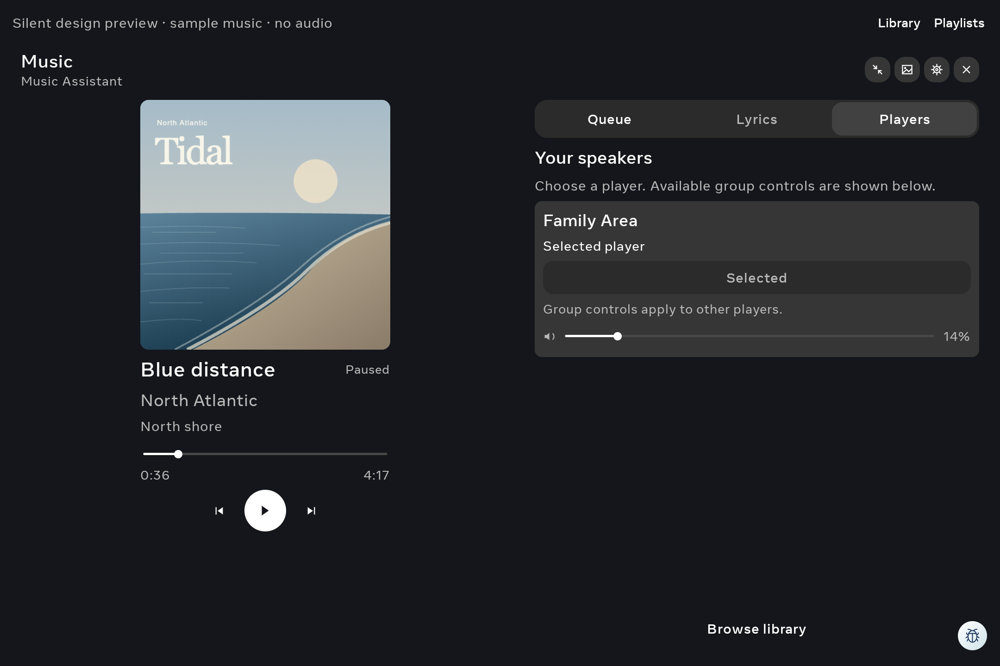

# Family native music drag verification

**Verified:** the tested seek and volume sliders follow the drag and emit one UI
action after release, with none while pressed or moving. Disabled controls emit
none and preserve their values. **429/429 assertions** pass across **20 gestures**
on the physical Family Area Portal.

This closes a functional verification gap. Production slider behavior was already
correct and was not changed. Family retains optimized, non-debuggable APK
**e4f8b0ce…**, including the preceding
[slider touch-area fix](portal-music-touch-native-2026-11-01.md).
Source commit **c2a578f0**, branch `codex/music-native-drag-20261101`.

The original 30-minute slot began **11:02:44 UTC** on November 1 and ends
**11:32:44**. Final native restoration and fresh health were verified by
**11:16:29**, **13 minutes 45 seconds** into that slot. The slot was not reset
for the first observer timeout. Living Area was untouched.

## Real input and observations

The test runs the real Compose music controls in the silent debug preview on
**Android 10 / API 29, 2160 × 1440, 180 dpi**, over wireless ADB.
Generated artwork and simulated data supply the content; no player controller,
audio output or provider connection is created.

Each gesture uses one continuous pointer stream: DOWN, **24 MOVE events**, UP.
The test observes native RangeInfo and debug action counters before input, after
press, halfway through the drag, before release and after release. It validates
the preview's ownership and focused window throughout, and cancels a held pointer
if the command aborts.

| Cases | Gestures | MOVE events | Emitted UI actions |
| --- | ---: | ---: | ---: |
| Dark/light × font 1.0/1.8, seek forward/reverse | **8** | **192** | **8**, each after release |
| Dark/light × font 1.0/1.8, volume forward/reverse | **8** | **192** | **8**, each after release |
| Dark/light offline, disabled seek and volume | **4** | **96** | **0** |
| Total | **20** | **480** | **16** |

Enabled cases drag between 15% and 85% of the observed control width in both
directions. Mid-drag values must progress toward the endpoint; final values must
reach it within the declared tolerance. Native bounds include the thumb's
insets, so those screen coordinates do not promise exact 15%/85% values.
Released seek values match the paused elapsed-time label; released volume values
match the confirmed percentage label. Volume deliberately keeps its confirmed
label while the thumb previews a drag.

All **60 pressed/mid/before-release samples** preserve their initial action
counts. Final values/counters are checked again against the final snapshot.
The **16** actions are counted at the UI callback, not at a live provider.

The final helper took **186.340 seconds** and recorded **36 native captures**.
The complete parent operation, including test-APK rollback, took
**216.786 seconds**. Those times include observer work and capture overhead;
they are not UI response latency or panel frame timing.

Four larger-text Queue/Players captures were visually reviewed in both palettes;
no overlap was observed in those samples. All 36 were not individually reviewed.

## First timeout and bounded correction

The first attempt completed two seek gestures and **45/45** available assertions,
then its 10-second observer allowance expired during the first volume capture.
Its overall result remains **failed/incomplete**.

After that observer reached terminal state and the original APK was restored,
the exact late generated snapshot and PNG were retrieved read-only. They show
volume progress **35 → 48.89435 → 85.61425 → 85**, with zero volume actions until
release and one afterward. The completed capture therefore arrived outside the
observation allowance; it was not evidence of a broken slider.

Gesture captures now get a separate **20-second bounded allowance** because they
include input and multiple observations before the final screenshot. Ordinary
snapshots retain 10 seconds; the existing work and cleanup deadlines remain.
One subsequent complete run passed. No production workaround was introduced.

The first helper registered only completed frames, leaving its late sixth
capture outside the parent's cleanup list. The subsequent parent removed that
exact owned filename before testing and included the last attempted filename
in cleanup. Fresh Fleet filesystem inspection verifies both exact owned
snapshot prefixes are absent. The first failed receipt is retained separately.

## Build and restoration

- **3,717 unit tests / 392 suites**, zero failures, errors or skips.
  Debug and Android test APK assemblies pass; the optimized APK was not rebuilt.
- Debug-only counters and the test-only observer add no work to the retained
  optimized app. The helper's focused review found no blocker.
- Original optimized and test APK hashes are restored. All **97 setting values**,
  **22 source fields**, persistent pin configuration, accessibility services,
  brightness policy and global font scale match their captured originals.
- Android's system process remained unchanged. The original Immortal Dream is
  restored, with no pin cover, instrumentation or active collector/listeners.
- Fresh health verifies the installed optimized hash, physical device identity,
  non-debuggable flag, preservation checks and owned-cache cleanup.

## Acceptance limits

This accepts the sampled drag progress, paused seek label, confirmed volume label
and release-only UI actions in the silent fixture. It does not establish
playing-timer interaction, cancellation semantics as a user operation, every
touch pixel, all intermediate rendered frames, real provider acknowledgements,
audio, speaker-group operations, production Home header/dock or panel FPS.
Cleanup's emergency CANCEL is a safety path, not an accepted cancellation case.

Physical brightness comfort remains pending because the user cannot test now.
Music provider/server wiring remains outside scope. The broader
optimization/screensaver/music goal is incomplete; parked performance
investigations were not reopened.

[Sanitized verification and phase/action summaries](../mocks/portal-premium-player-20261030/evidence/family-music-drag-native/verification.json).
Credentials, raw device snapshots, configuration backups and rollback APKs
remain private outside Git.
