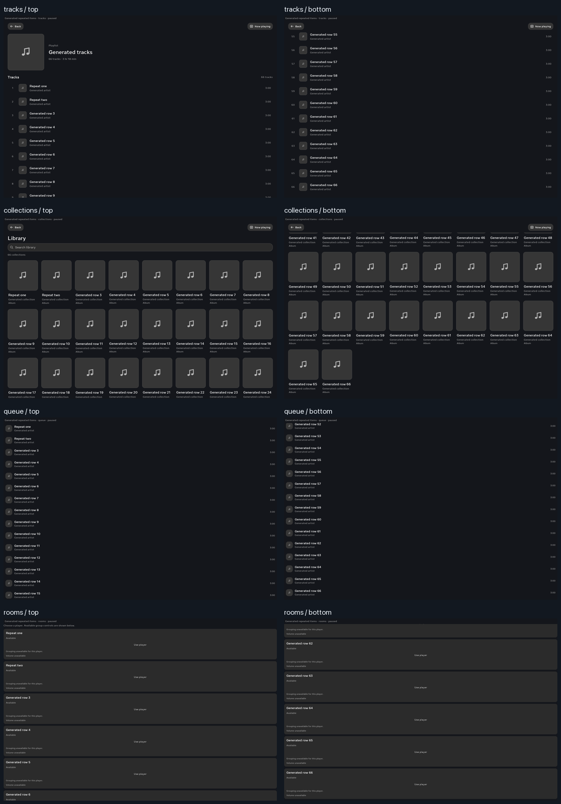

# Repeated music items — Family Area

Music lists now distinguish a row's identity from the ID used by playback
callbacks. A playlist can contain the same song more than once. Previously,
those occurrences used the same Compose lazy key, violating the framework's
unique-key requirement. Provider IDs could also collide with static header or
missing-ID keys.

The correction applies to collection tracks, library/playlist grids, queues
and player lists. It does not deduplicate, remove or reorder supplied data.
Original IDs, objects, selection logic, artwork identity and callbacks remain
unchanged.

Family Area has optimized, non-debuggable APK **d4b2d1e2…**, signed with the
existing certificate. Branch: `codex/slideshow-style-matrix-20261101`.
Living Area was untouched. No provider, server or Home Assistant installation
was performed.

## Identity and performance

`musicItemKeys` returns namespaced, Bundle-saveable Strings. Identifiable rows
use the ID plus its occurrence count. Missing IDs use a separate fallback
namespace; their existing disabled-control behavior remains intact.

Each UI caches its key table with `remember` on the corresponding dataset.
Key construction is linear in the item count, with one ID read per item;
per-item lazy key lookup is constant time. Unrelated inserts and reorderings
preserve identifiable keys. Player headings and cards have separate content
types, keeping their recycled composition slots distinct.

The key regression tests 10,000 entries containing repeated IDs and confirms
10,000 unique keys with exactly 10,000 ID reads. This is an algorithmic check,
not a measured frame-time or CPU improvement.

Occurrence identity has a limit: inserting or removing an earlier occurrence
of the same ID renumbers later occurrences of that ID. Exact identity across
such edits requires a distinct entry ID from the host. This change does not
make duplicate queue/player IDs unambiguous for provider commands.

## Evidence

| Gate | Result |
| --- | --- |
| Raw-ID key behavior in the initial helper regression | **5 failures / 8 tests** |
| Corrected key regression | **8/8 passing** |
| Full freshly executed unit gate | **3,756 tests / 393 suites**, no failures, errors or skips |
| Debug, optimized and Android test APK builds | Passed |
| Actual Android 10 component rendering and scrolling | **30/30 checks**, four cases, eight window captures |
| Native probe duration | **13.796 seconds** |
| Read-only review | No concrete blockers |

The native fixture supplies 66 generated entries per list, including two
different titles with the same ID. It renders the real production components.
Each case checks the first two titles, an observed local touch scroll, the
actual lazy-list/grid scroll-to-index action, the final row and different
top/bottom pixels. PixelCopy captures the owned Android window after genuine
draw callbacks.

| Component | Repeated entries visible | Touch scroll | Final row 66 | Captures |
| --- | --- | --- | --- | ---: |
| Collection tracks | Passed | Passed | Passed | 2 |
| Collection grid | Passed | Passed | Passed | 2 |
| Queue | Passed | Passed | Passed | 2 |
| Players | Passed | Passed | Passed | 2 |

The queue/player functions are now module-internal so the debug fixture can
reuse their actual implementations without private reflection or a synthetic
replacement. The fixture creates no controller, artwork files, provider
connection, audio output or running playback timeline. It uses public Compose
semantics and its own window; it does not acquire UiAutomation or wait for
application-wide idle.

This verifies sampled generated component rendering and scrolling on the real
Portal. It does not reproduce an old-version device crash, accept every
intermediate frame, test provider/group commands, or establish panel FPS.
The pre-fix evidence is the source contract and failing key regression.

The contact sheet reduces the original window captures. All content is generated;
the supplied blank artwork URIs intentionally exercise the existing fallback
artwork. It is not a new visual design or a household music library.

## Build failure and restoration

The first full gate passed. A subsequent final build failed four
`FaceFocusStoreTest` cases when temporary-file creation reported **No space
left on device** on the Mac. That failed attempt is retained privately.
After its process ended and space recovered, the complete gate was rerun with
one Gradle worker and in-process Kotlin compilation. All tests and builds
passed; no assertions were altered to hide the infrastructure failure.

Final restoration checks confirm all **97 settings**, photo sources,
persistent pin, accessibility list, font scale and brightness policy match
the private baseline. The Android system process is unchanged. The original
test APK and Dream are restored; the optimized candidate is installed.
Owned probe activities are destroyed, generated device files are removed, and
no instrumentation or performance collector remains active.

The original issue slot began **13:29:01 UTC** on November 1 and expires
**13:59:01**. Native verification, restoration and cleanup completed in
**15 minutes 28 seconds**, without resetting that cap.

Physical brightness comfort remains pending, and the broader goal remains
incomplete. Music provider/audio wiring remains deliberately deferred.

[Native checks](../mocks/portal-premium-player-20261030/evidence/native-music-repeated-items/checks.json)
and [sanitized deployment receipt](../mocks/portal-premium-player-20261030/evidence/native-music-repeated-items/verification.json).

## Official references

- [Android lazy-list API contract](https://developer.android.com/reference/kotlin/androidx/compose/foundation/lazy/package-summary):
  “Using the same key for multiple items in the list is not allowed.”
- [Compose item keys](https://developer.android.com/develop/ui/compose/lists#item-keys):
  stable unique keys preserve item state, and Android keys must be Bundle-saveable.
- [Compose performance practices](https://developer.android.com/develop/ui/compose/performance/bestpractices):
  stable keys and matching content types support composition reuse.
