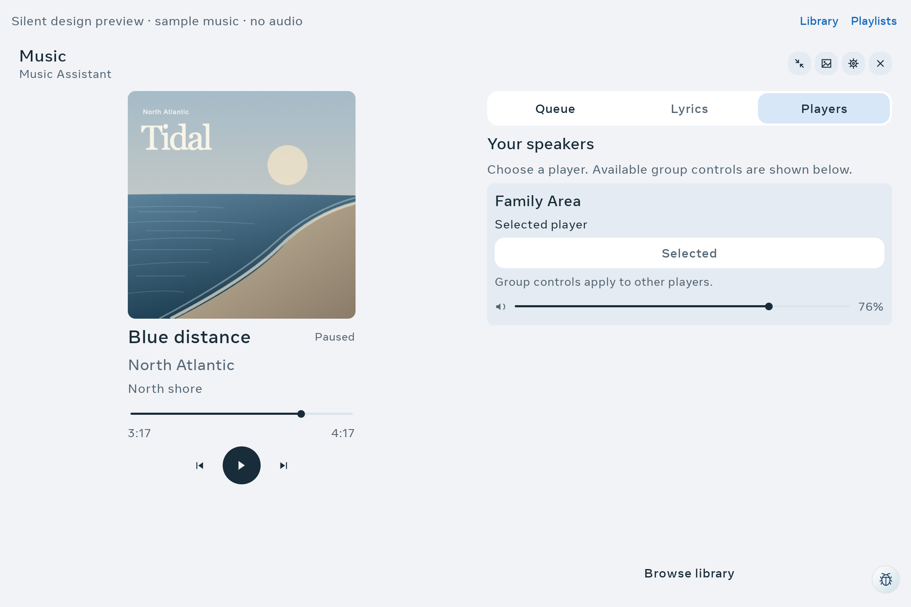

# Family music slider touch fix

**Delivered:** the native seek and volume sliders respond to the tested taps near
their upper and lower edges. The visible thin rail and small thumb are retained.
Family Area has optimized, non-debuggable APK **e4f8b0ce…**, signed with the existing
certificate. Source commit **2773bc1a**, branch `codex/music-native-touch-20261101`.

The original issue slot began **10:42:08 UTC** on November 1, with a hard deadline
of **11:12:08**. Installation, fresh device health and source commit were verified
by **11:00:44**, **18 minutes 36 seconds** into that slot. Living Area was untouched.

## Actual defect and change

The existing outer slider row reserved 48 dp. Material3 measured its inner
gesture layout from the custom thumb and track, leaving only **16 dp / 18 px**
of native slider height on Family's 180 dpi display. All **16/16** sampled edge
taps were ignored in the baseline.

`MusicSlider` now measures its thumb Canvas at **16 × 48 dp**. `drawCircle`
still uses the shorter dimension, preserving the **16 dp / 18 px** painted thumb.
The thin rail is unchanged. Material's inner gesture height becomes
**48 dp / 54 px**, fitting the space already reserved by the caller.
This adds no timer, animation, image decode or background producer. It is a
touch correctness improvement; CPU/GPU/FPS gains were not measured.

The measurement behavior was checked against the resolved
[Material3 Android 1.4.0 source archive](https://dl.google.com/dl/android/maven2/androidx/compose/material3/material3-android/1.4.0/material3-android-1.4.0-sources.jar):
`Slider.kt` measures `sliderHeight` as the maximum of its track and thumb heights.
Outer minimum-interactive spacing alone did not enlarge that inner layout.

## Native verification

The actual Family Portal ran the real Compose music components through a silent
debug preview on **Android 10 / API 29, 2160 × 1440, 180 dpi**, over wireless ADB.
Generated artwork, tracks and simulated acknowledgements supplied the data.

| Check | Before | After |
| --- | ---: | ---: |
| Native enabled slider height | **18 px / 16 dp** | **54 px / 48 dp** |
| Sampled edge taps producing confirmed value changes | **0/16** | **16/16** |
| Visible thumb height | **18 px** | **18 px** |
| Baseline focused assertions | **80/96** | — |
| Final focused assertions, including 16 additional height gates | — | **112/112** |

Four ready cases cover dark/light palettes and font scales **1.0/1.8**.
Seek and volume each receive taps at 25% and 75% of their width, respectively
**25 px above and below** the observed center. These points are about 2 px inside
the enlarged bounds and outside the painted thumb. Tests require a meaningful
native range-value change plus matching elapsed-time or volume text.
Two offline cases verify disabled sliders preserve their values.

Queue checks also verify Compose's non-tab selection mapping:
`checkable=true`, `checked=current`, `selected=false`, and a nonempty
`AccessibilityNodeInfoCompat.stateDescription`. On API 29 the compatibility
class retrieves that description from extras. The earlier false `selected`
flag was not a product defect. Exact spoken wording and TalkBack operation
were not tested.

The final native helper took **87.116 seconds**, produced **36 captures**, and
reported zero suspected UI bugs. The complete parent operation, including
rollback from the test APKs, took **119.725 seconds**.
Four larger-text Queue/Players captures were visually reviewed in both palettes;
no overlap was observed in those samples. All 36 were not individually reviewed.

## Build, delivery and preservation

- Full gate: **3,717 unit tests / 392 suites**, zero failures, errors or skips.
  Debug, optimized performance and Android test APK assemblies pass.
- Independent focused static review found no blocker and documented the sampled
  touch and silent-fixture limits.
- Optimized deployment took **18.899 seconds**. The installed full APK hash,
  signing certificate, non-debuggable flag and physical device identity passed.
- All **97 setting values**, **22 source fields**, persistent pin configuration,
  accessibility services and global font scale match the original snapshots.
  Android's system process remained unchanged. The original Immortal Dream
  was restored; instrumentation, its owned snapshot cache and collectors retired.
- Automatic-brightness **mode and adjustment** are preserved exactly. The raw
  brightness setting changed during the native run under automatic mode, so that
  raw comparison remains false in the receipt. The baseline parent had incorrectly
  required raw-value equality without capturing mode/adjustment and reported
  restoration failure; that historical result is retained. The final parent
  captures policy first and requires raw equality additionally in manual mode.
- Fresh health confirms the new optimized hash, original Dream, clean pin state,
  exact settings/sources and no instrumentation or active collector/listeners.

The test preview now acknowledges simulated room-volume changes, and the native
observer exports range and compatibility state-description fields. Those changes
are test support, not music backend or audio implementation.

## Acceptance limits

This closes the sampled seek/volume edge-touch gap and the queue's native
selection-state qualification in the silent UI. It does not establish every
touch pixel, dragging, live provider acknowledgements, real audio, speaker-group
commands, the production Home header/dock, panel FPS or brightness comfort.
Provider/server wiring remains outside scope. The user's physical lighting
check is pending; no repeat request was made.

The broader optimization/screensaver/music goal remains incomplete. Parked
performance investigations were not reopened.

[Sanitized receipts and reviewed captures](../mocks/portal-premium-player-20261030/evidence/family-music-touch-native/verification.json).
Credentials, raw device snapshots, configuration backups and rollback APKs
remain private outside Git.
