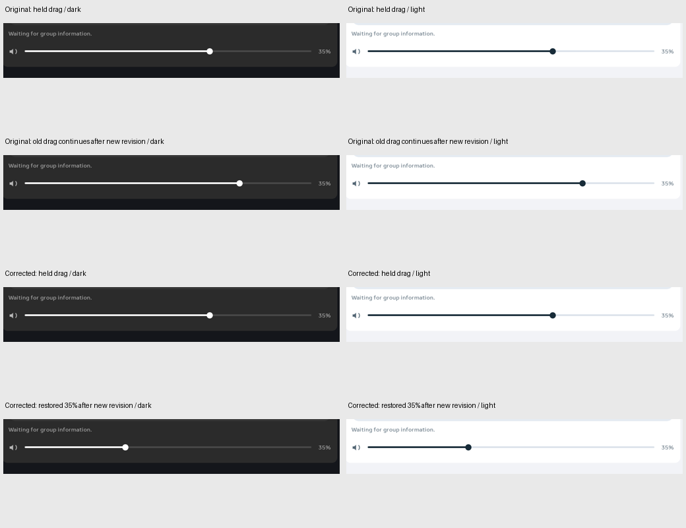

# Family Area volume-gesture ownership — November 1, 2026

**Fixed and deployed on Family Area.** An active volume drag now belongs
to its source/session observation and room. Replacing that binding retires
the control: further movement or release from the old gesture cannot become
a volume command for the new observation. A fresh gesture works. Ordinary
title and reported-volume changes preserve the existing drag.

| Same native check set | Original | Corrected |
|---|---:|---:|
| Assertions, same 88 ordered labels | 10 failures | 88/88 passing |
| Scenarios across dark/light | 12 | 12 |
| Old releases accepted after source/revision replacement | 4 | 0 |
| Releases accepted with unchanged binding, new title or new volume report | 6 | 6 |
| Fresh gestures accepted | 12 | 12 |
| Draft after a new revision | 64.639% | reported 35% |
| Further MOVE from the old gesture | 75.120% | remains at 35% |
| Isolated failures | 0 | 0 |
| Native fixture work | 9.142 s | 9.548 s |

## Cause and implementation

`MusicRoomVolume` remembered its draft by source and room, but retained the
Material Slider's pointer state across a new presentation revision. Its
finish callback was updated by recomposition. The old gesture could therefore
release through a callback capturing the new snapshot and pass the existing
rendered-action guard.

The entire volume leaf is now inside a Compose key containing source ID,
local session token, presentation revision and room ID. Its draft uses plain
`remember`. Production advances the presentation revision when the source,
connection configuration, MA leader or queue binding changes. Reported volume,
room name and track metadata are excluded from the key. Existing availability
gating and server-confirmed percentage labels remain intact.

This replaces one UI leaf on binding changes. It adds no observer, timer,
image owner, setting, provider or audio connection. There is no measured FPS
or CPU-savings claim, and the fixture timings are not a performance comparison.

## Evidence and deployment

The debug-only, silent host uses generated paused data and the production UI
and rendered-action guard. Native MotionEvents hold, move and release the
slider while its binding is changed. Both palettes cover unchanged data,
title update, volume report, revision replacement, source replacement and
room replacement. Room replacement already cancelled correctly before this
fix. The matrix does not establish every capability-loss, arbitrary
`ACTION_CANCEL`, local-session replacement or real provider/audio behavior.

Four Window captures per run corroborate the reset at identical slider
bounds. In both palettes, the original painted right edge moves
**1,769 → 1,856 px** after continued movement on a new revision; the corrected
edge moves **1,769 → 1,523 px**, matching the authoritative 35%. The comparison
image was visually inspected. These are native fixture pixels, not physical
finger routing, source acknowledgements or delivered panel FPS.

Fresh debug, optimized and instrumentation builds plus **3,765 JVM tests
across 395 suites** pass, with zero failures/errors/skips, in **4m 21s**.
The optimized APK uses the existing signing certificate and has SHA-256
`3c15a465e43f2109bdba83adbfef2978c67088c5cf01cf2752ff641b1910351a`.
It was installed over wireless ADB and verified at **17:32:35.411 UTC**,
**10 minutes 31 seconds** into the original **17:22:04–17:52:04 UTC** slot.
That deadline was never reset. Living Area was untouched.

The final receipt verifies all **97 settings**, sources, face-cache bytes,
accessibility services, persistent pin, brightness values/policy, original
test APK and Immortal Dream. The system-server PID is unchanged. No
instrumentation/performance collector remains active; owned device evidence
is removed. Household configuration, credentials and rollback APKs remain
outside Git. This host returns before creating any photo controller.

The physical natural-light fade/comfort check remains pending. Previously
parked work remains parked, provider/audio wiring remains deferred, and the
overall platform goal remains incomplete.

[Baseline checks](../mocks/portal-premium-player-20261030/evidence/family-music-volume-binding/baseline-checks.json) ·
[Corrected checks](../mocks/portal-premium-player-20261030/evidence/family-music-volume-binding/checks.json) ·
[Pixel proof](../mocks/portal-premium-player-20261030/evidence/family-music-volume-binding/pixel-proof.json) ·
[Unit gate](../mocks/portal-premium-player-20261030/evidence/family-music-volume-binding/unit-gate.json) ·
[Restoration](../mocks/portal-premium-player-20261030/evidence/family-music-volume-binding/verification.json).

