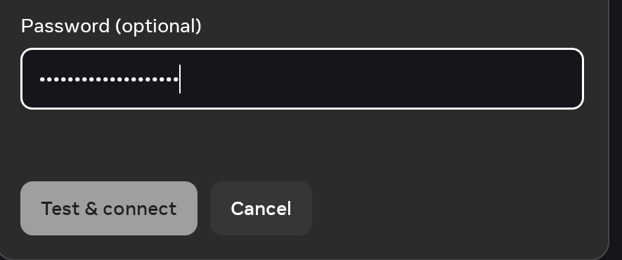
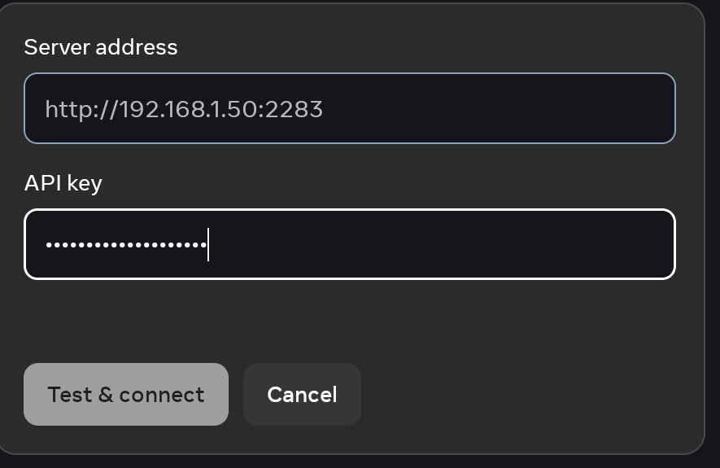
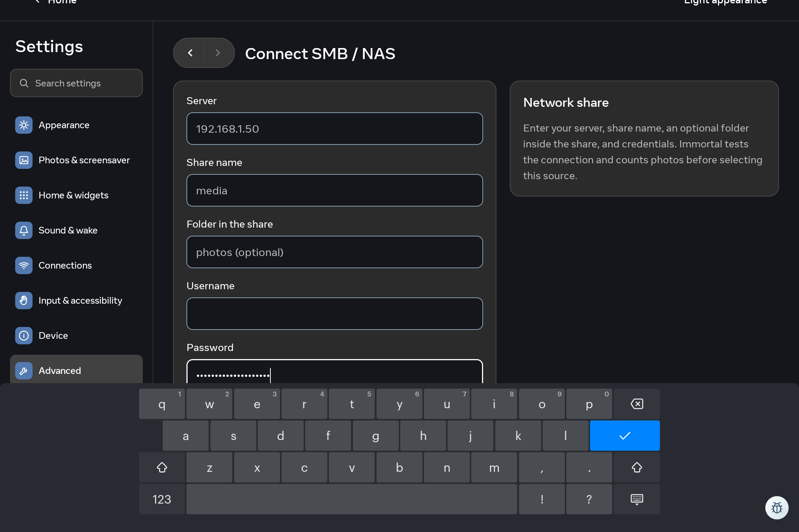

# Native photo-source drafts — 2 November 2026

One bounded Family Area unit, **17:35:44–18:05:44 UTC**, on
`codex/settings-native-source-drafts-20261102`, based on `1f6c19a4`.
Normal Wi-Fi ADB input exercised the existing source forms on Android 10.
Only generated unsaved text was entered. No Test & connect action, album
selection, authentication or provider operation was requested.

## Native observations

| Existing form | Observed result |
| --- | --- |
| WebDAV | Empty and whitespace-only URL keep Test & connect disabled. A generated URL enables it; it was never pressed. Password is masked with the keyboard open and after blur. Cancel/reopen restores the original fields. Two Android Back presses dismiss the keyboard and form; reopening restores the original fields. |
| SMB / NAS | Generated server, share, folder, username and password drafts remain unsaved. Password is masked. Cancel/reopen restores the original empty fields and their placeholders. |
| Immich | Generated API key is masked with the keyboard open. Cancel/reopen restores the original fields. The regular connect form was used; the separate album route was avoided because it can initiate a connection with saved credentials. |

Complete private profile readbacks match the baseline at every captured stage.
The observed WebDAV editor also reports native IME `inputType=0x81`,
`noAutoCorrect password`; this does not establish TalkBack or accessibility-tree
acceptance. Draft masking does not claim that previously saved secrets are
absent: the existing forms prefill saved values and mask them.

Only form crops containing generated drafts or placeholders are public:

## Reproduced keyboard defect and withdrawn candidate

SMB's long form pans upward when Password opens the keyboard. The Home control
is clipped at the top and Test & connect / Cancel are covered. A body swipe did
not expose the actions. This is a reproduced layout defect, not a credential
persistence defect.

A candidate added `adjustResize` to the three credential Activities, matching
the main Settings manifest setting. Candidate **1.81 / code 75** passed debug
and optimized assembly, R8/vital lint and **3,869 JVM tests across 406 suites**,
zero failures, errors or skips; the build took 1m8s.

Independent source review warned that Portal's global `immersive.status=*`
forces fullscreen behavior, which Android 10 can prioritize over resizing.
Family's actual global policy is `immersive.status=*`. Native candidate testing
confirmed the same pan/clipped-Home/covered-actions result. **The candidate failed
acceptance. It was withdrawn, all three source/version changes were reverted,
and Family was restored to the original exact 1.80 APK. Living received no
candidate installation. No keyboard fix or performance improvement is claimed.**

The private candidate remains available for traceability, with optimized SHA-256
`6d2986b872cfed0eaf39e3138596a65978af59ff4b26e7435c6274cea75d5ba7`.
This artifact must not be promoted.

## Restoration and boundaries

Full installed APK readbacks in both rooms match accepted **1.80 / code 74**:

`988881568224a8bfe69b249789e05ed13395c51fad71adb092ac85a77c2b56d6`

Complete profile/layout/screensaver snapshots match both baselines. Family's
font and enabled/binding accessibility state are preserved, original Chrome task
27174 remains listed, and the baseline manual `PhotoFramePreviewActivity` is
resumed. No natural Dream recovery, process continuity, real source connection,
alternate theme/font scale, D-pad or broad performance acceptance is implied.

Private captures, snapshots, candidate, build log and restoration receipt:
`/private/tmp/portal-settings-native-source-drafts-20261102/`.

The credential masking/unsaved Cancel gap is accepted at the observed scope.
The SMB keyboard issue is parked under this bounded unit; its next authorized
attempt needs a solution compatible with Portal fullscreen policy, rather than
another manifest-only retry. Weather and all prior exhausted slots keep their
existing boundaries.
