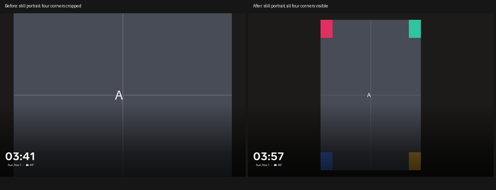
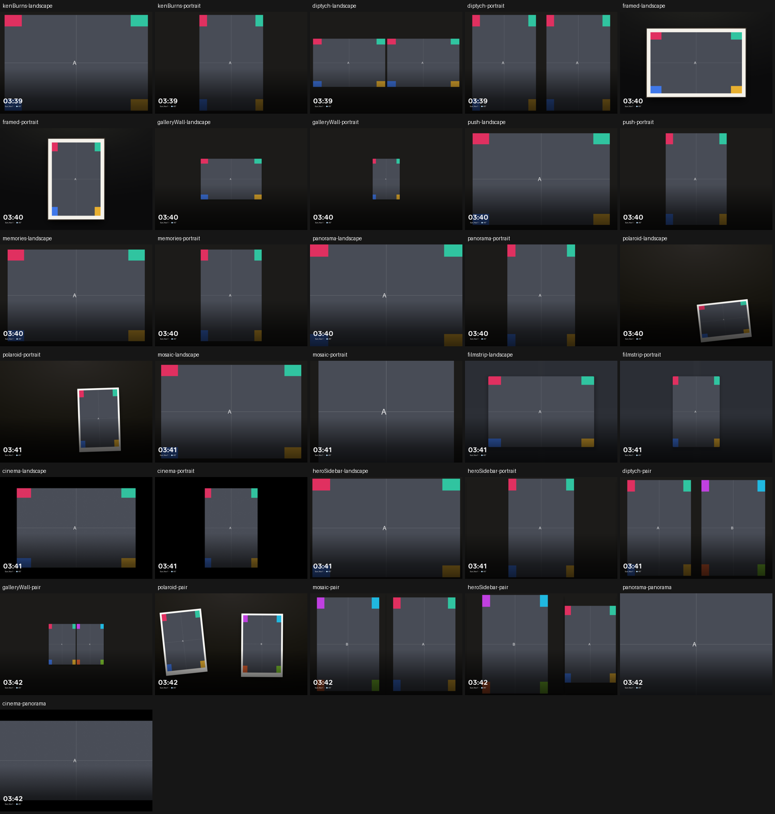

# Still Mosaic photos and native style coverage — Family Area

**Delivered:** still and face-protected Mosaic photos retain the whole image
inside their tile. The previous stopped-pan layout enlarged mismatched images
and left their edges cropped even though animation was disabled.

Source **8645cbcc**, branch `codex/slideshow-style-matrix-20261101`.
Optimized, non-debuggable APK **bfc9430d…** is installed on Family Area with the
existing signing certificate. Living Area was not changed.

The issue slot began **11:36:45 UTC** on November 1, with its original hard
deadline **12:06:45**. Fresh native qualification and device health passed before
**11:58:48**, within **22 minutes 3 seconds**. The cap was not reset.

## Reproduced defect and correction

The real Portal's Mosaic portrait capture lost all four generated corner
markers. Its image box retained the oversized geometry intended for a moving
vertical pan. Disabling animation alone could not restore the hidden edges.

Mosaic now chooses that geometry only when photo motion is enabled and no
cached face keeps the image still. The existing 92% contained image box applies
otherwise. Static images have no transform, animation or image-layer promotion.
Moving/no-face output hashes remain unchanged.

The new regression first failed against the original code. Two existing tests
had encoded the stopped crop and were corrected to verify actual contained
geometry, cell retention and face positions including letterbox offsets.
Other animation and lifecycle protections remain.

## Native coverage, with qualifications retained

Wireless ADB captured **31 actual PhotoDreamService frames** on the physical
Android 10/API 29 Portal+, **2160 × 1440, 180 dpi**. These used generated PNGs,
motion disabled, long dwell, and dark-room clock disabled. No emulator,
instrumentation or collector supplied the pixels.

The survey covers landscape and portrait sources in Ken Burns, Diptych,
Gallery Wall, Memories, Polaroid, Mosaic, Filmstrip, Cinema, Push, Panorama,
Hero Sidebar and Framed Print. It adds five portrait-pair cases and two wide
panorama cases. This survey took **180.851 seconds**, including restoration.

A separate optional checker permits spatially varying black shading using one
shared RGB multiplier per pixel, while retaining the Gallery oracle's geometry
checks. It does not alter the original exact-color Gallery checker.

| Original survey classification | Cases | Meaning |
| --- | ---: | --- |
| Strict checker passes | **9** | Complete markers and axis-aligned whole-photo geometry |
| Strict marker-area failures | **16** | Geometry checks pass, but some marker pixels fail; these are qualified, not relabeled as passes |
| Outside the checker contract | **5** | Three rotated Polaroid cases and two intentional immersive panorama crops |
| Reproduced missing corners | **1** | Mosaic portrait: all four corners absent |

The 16 marker-area failures remain recorded. Targeted review identifies rounded
corner clipping in Gallery Wall portrait and intentional grain in Cinema
portrait. That does not prove every remaining marker-area failure harmless.
The survey is static coverage, not motion, visual-quality or frame-rate
acceptance for every style.

## Delivered Mosaic geometry

The installed APK was then checked with portrait and wide panorama sources.
Both retain all four corners, correct aspect and bounded photo geometry:

| Source | Native photo bounds | Relative aspect error | Qualification |
| --- | ---: | ---: | --- |
| Portrait 800 × 1200 | **883 × 1324** | **0.0378%** | All corners and geometry pass; strict marker-area failure retained |
| Panorama 2400 × 800 | **1988 × 663** | **0.0503%** | Strict checker passes |

The first fixed-portrait parent terminated with a failed strict contract and
successful restoration. It was not counted as a passing run.

Independent pixel review found exactly **one rejected pixel**, on the top-right
boundary of the bottom-left portrait marker, consistent with fractional
contained-image rasterization. The other three markers match completely.
No rejected pixel lies inside any marker after excluding its one-pixel border.
The subsequent bounded capture records this as a **separate geometry
qualification**, preserving the strict checker failure and its diagnostic.
The panorama needs no qualification. The final capture/restoration took
**11.480 seconds**.

## Build, review and restoration

- **279 slideshow JavaScript tests pass**, including legacy output hashes,
  motion-off bounds, cached-face containment and cell lifecycle.
- **14 optional shaded-checker tests** and **11 existing Gallery-checker tests**
  pass. Missing, cropped, occluded and distorted markers still fail.
- Debug and optimized Android builds pass in **41 seconds**.
  `testDebugUnitTest` is **UP-TO-DATE**: the retained result is **3,722 tests,
  392 suites, zero failures/errors/skips**, not a newly executed full unit run.
- Independent review found no concrete blockers in the Mosaic patch and
  verified **70 focused JavaScript tests**, including existing motion hashes.
- Deployment took **18.931 seconds**. Fresh device health confirms the exact APK,
  non-debuggable build, **97 settings**, **22 source fields**, pin cleanliness,
  accessibility state, font scale, automatic-brightness policy and original
  Immortal Dream. Owned synthetic device files were removed.

This correction adds no timer, decode, settings read or animation work.
CPU/GPU/frame-time improvement was not measured.

Household media, connection credentials, configuration snapshots and rollback
APKs remain private. Public evidence contains only generated images, geometry,
artifact hashes and sanitized checks.

The user's natural room-light and optical brightness-comfort check remains
pending because they cannot test now. Provider/audio wiring is outside the
music UI scope. Motion acceptance for the complete legacy style matrix and
whole-platform performance acceptance remain open; the broader goal is
incomplete.

[Sanitized evidence](../mocks/portal-premium-player-20261030/evidence/family-slideshow-style-matrix/)
