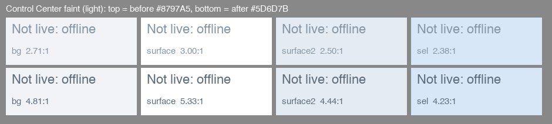
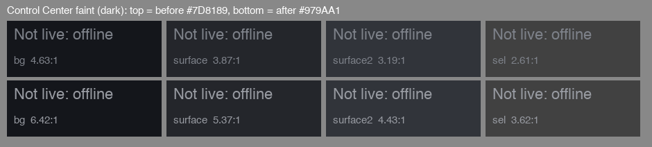

# Accessibility and usability audit (2026-11-20)

Base: main 1.297 (versionCode 291). Branch `a11y-audit`. Checklist: every interactive element has
a label and a role, grids are containers, touch targets are at least 64 dp, and the light and dark
themes are both readable ([quality gates](../design/portal-plus-quality-gates.md) D5, D6, G9).

## Method

1. **Static scan** of `app/src/main/java` for `clickable`, `combinedClickable`, `toggleable`,
   `selectable`, `tvFocusable`/`tvFocusableRow`, `detectTapGestures` and `IconButton` (308 sites),
   checking each for a role and a label source (own `Text`, `contentDescription`, or a labelled
   helper), plus every composition root (`setContent`, `Dialog`, `Popup`).
2. **Device dumps** on the Family Portal+ (official 1.297) with `uiautomator dump` only (no
   screenshots): Home, Apps, Tools, Settings, Control Center, Music and Calls, at the native
   2160×1440 @ 180 dpi (1920×1280 dp), and emulated Mini sizes 1280×800 and 800×1280 @ 160 dpi
   (`wm size`/`wm density`, reset afterwards). Sizes are measured in dp at the real density.
   Each clickable node was checked for: no text/description in its subtree, either side under
   64 dp, labels like "Button"/"Image", duplicate labels, and `android.view.View` class (Compose
   reports a node with no role as a plain View).
3. **Contrast**: WCAG ratio for every foreground/background pair of `ApprovedLightPalette`,
   `ApprovedDarkPalette` (which also back Home, Settings `Ios*` and Material roles) and Control
   Center's `CcLight`/`CcDark`.

Note: the baseline 1280×800 run rendered upright (the launcher's orientation hook rotated it), so
the baseline has compact portrait only. The after run forced landscape with the fleet `orientation`
hook (then `auto`), so compact landscape has after numbers only.

Role check: Compose sets `android.widget.Button`/`CheckBox`/`RadioButton` as the class name.
On a node that merges text it puts the class on a text-less child node, and `Tab`/`Switch`
only on `roleDescription`, which `uiautomator` doesn't dump. A clickable counts as role-less when
neither it nor such a child carries a widget class.

## Findings

| # | Severity | Where | Finding (before) | Status |
|---|---|---|---|---|
| F1 | High | Every screen | Almost no clickable had a role: 110 of 142 clickable nodes across the 7 Portal+ dumps (96 of 121 on the Mini) carried no role (header buttons, app tiles, Tools rows, Settings rows, widget chips). TalkBack says the label with no "button"/"tab" | **Fixed**: `tvFocusable`/`tvFocusableRow` default to `Role.Button` (callers whose own semantics declare Switch/Radio/Checkbox/Tab pass `role = null`); every raw `clickable`/`combinedClickable`/`toggleable` site declares a role |
| F2 | High | Home/Apps/Tools dock | Tabs exposed as plain views with no selected state | **Fixed**: `Role.Tab` + `selected`, row is a `selectableGroup` |
| F3 | High | Home widget page dots | Two clickable dots with no label (`''`, 8 dp drawn, 23×48 / 48×48 dp hit) | **Fixed**: "Widget page n", `Role.Tab`, `selected`, action label |
| F4 | High | Mini header (8 buttons), Mini widget Settings chips, CC chips/actions | Touch targets 56×56 dp (header), 71×41 dp (widget Settings), 51–61 dp (Control Center pills, Arm/Turn-off actions, Back on the Mini, where CC renders at 75% density) | **Fixed** without layout change: every window raises Compose's minimum touch target to 64 real dp (`ProvideHearthpaneTouchTargets`), corrected for CC's 75% scale and the Mini's denser widget cards |
| F5 | Medium | Portal+ Home | Customize 149×52, widget Settings 84×48, Add calendar 178×52 dp | **Fixed** by F4 |
| F6 | Medium | Settings | Search field 48 dp tall | **Fixed** by F4 (hit area) |
| F7 | Medium | Scrims and sheets: APK install, CC sheet/modal/PIN, Dinner call, household lists, Music popovers, Bedtime story, popup scaffold, Wake light | Card "click swallowers" were `clickable {}`/`tvFocusable {}` no-ops: announced as buttons that do nothing and merged the whole card's text into one node. Parent scrims merged the sheet they host | **Fixed**: swallowers use `blockScrimTaps()` (consumes taps, no semantics); parent scrims use `dismissScrim()` (one labelled Close/Cancel action, no merging); sibling scrims got a role and "Close" |
| F8 | Medium | Icon-only controls | Music card play/pause (artwork only), remove badge (canvas cross), Tools close ("✕"), Who's-there colour swatches had no meaningful label | **Fixed**: "Play"/"Pause", "Remove", "Close", "Colour n" + radio role/selected |
| F9 | Medium | Home alarm switch, HA dashboard tiles | Switches exposed as plain clicks with no state or label | **Fixed**: `toggleable(role = Switch)` + "Alarm" label |
| F10 | Medium | Home widget grid, favorites strip, CC device tiles | Not exposed as containers | **Fixed**: `collectionInfo` on the grid/strip, `collectionItemInfo` (row/column spans) per widget. Lazy grids (Apps, Tools, Calls, widget picker) already were |
| F11 | Medium | Control Center `faint` text (17–19 sp reasons, counts, stale status) | Light 2.38–3.00:1, dark 2.61:1 on selected | **Fixed** (token change, see Contrast) |
| F12 | Low | Widget card long-press container | Announced a click that does nothing | **Fixed**: `role = null`, no click label, long-press label "Customize Home" |
| F13 | Low | Duplicates | Five identical "Read" buttons in Bedtime story; "Settings" on every widget header, "Video call"/"Audio call" per room, "Show on Home", CC door alert repeated 3× | **Fixed** for Bedtime ("Read <title>"). **Open** for the rest: they need the card or room name, which is a copy change for the owner |
| F14 | Low | Rows at a scrolled viewport's edge (Settings bottom row, Mini Tools "Advanced" tab, Mini landscape Apps/Tools bottom row) | Reported small or unlabeled because the viewport clips them | Not a defect: full size and labelled when scrolled into view |
| F16 | Low | Small controls at a card or row edge (widget Settings chip 64×61, Mini "Add calendar" 136×63, page dot 64×57 dp) | The 64 dp area is cut by the parent card's clip by 1–7 dp | **Residual**: closing the gap needs layout padding, which is a visual change |
| F15 | Info | Dividers/outlines, CC plan `dotOff`, page-dot inactive | Non-text graphics under 3:1 (see Contrast) | **Not applied**: decorative or state also shown in text; owner decision |

Before/after device numbers are in [Device verification](#device-verification).

## Contrast

All `ApprovedPalette` text pairs pass: text and secondary are ≥ 4.5:1 on every background in both
themes. Accent, error and green are large-text/icon colours (≥ 3:1 everywhere). Small text in
these colours is below 4.5:1 on some backgrounds (light error on background 4.17, light green on
surface 4.24, accent on selected 4.37). These are large-text-only and were left alone.

**Applied (token under 3:1 with real text use): Control Center `faint`.**

| Theme | Background | Before `faint` | After `faint` |
|---|---|---|---|
| Light | bg `#F2F3F7` | `#8797A5` **2.71** | `#5D6D7B` **4.81** |
| Light | surface `#FFFFFF` | 3.00 | 5.33 |
| Light | surface2 `#E5EBF2` | 2.50 | 4.44 |
| Light | selected `#D7E7F8` | 2.38 | 4.23 |
| Dark | bg `#14161B` | `#7D8189` 4.63 | `#979AA1` 6.42 |
| Dark | surface `#24262B` | 3.87 | 5.37 |
| Dark | surface2 `#31343A` | 3.19 | 4.43 |
| Dark | selected `#414141` | **2.61** | 3.62 |

Light `faint` is now close to `sec` (1.12:1 apart), so faint text reads less "faint". **Owner check.**

**Not applied (non-text, owner decision):**

| Token / use | Light | Dark | Why left |
|---|---|---|---|
| `outline` card edge on background / surface | 1.38 / 1.53 | 2.54 / 1.99 | Decorative: cards already differ by fill |
| `divider` on background / surface | 1.17 / 1.29 | 1.98 / 1.55 | Decorative separators |
| Widget page dot, inactive (`secondary` @ 45%) | 1.90 | 2.83 | "n of m" text states the page |
| CC plan `dotOff` (device off) on plan backgrounds | 1.28–1.61 | 1.24–2.20 | Raising it makes off devices look on; needs design |
| CC `amber` on selected (warn text) | 2.99 | n/a | Marginal; amber tiles sit on surface (3.77) |

## What changed

- `ui/theme/HearthpaneTouchTargets.kt`: `ProvideHearthpaneTouchTargets` wraps `LocalViewConfiguration`
  with a 64 dp `minimumTouchTargetSize`, corrected when a subtree rescales density. Compose
  hit-tests the expanded area only when nothing is hit directly, and accessibility bounds follow
  it. Applied in `PortalPrimeTheme`, `CcTheme`, the Mini widget-card density, each Home page
  ComposeView, the 7 roots without `PortalPrimeTheme` and all 14 `Dialog`/`Popup` windows.
  Nothing is drawn or laid out differently.
- `TvFocus.kt`: `role: Role? = Role.Button` on both helpers. The disabled path keeps the role.
- `ScrimModifiers.kt`: `dismissScrim()` and `blockScrimTaps()`.
- Roles, labels, tab and switch semantics, collection info at the call sites listed in F1–F12.
- `ControlCenterTheme.kt`: `faint` light `#5D6D7B`, dark `#979AA1`.

## Tests

- `AccessibilitySourceScanTest` (source scan, pure JVM):
  - every raw interactive modifier declares `role =`;
  - every interactive element's owning composable has a label source;
  - no no-op click handlers;
  - every `setContent`/`Dialog`/`Popup` root applies the touch-target floor;
  - `tvFocusable` defaults to a Button role.
  
  Each rule fails with `File.kt:line`. Mutation check: removing a role, a remove-badge label or a
  root's wrapper, or restoring a no-op swallower, each turned the matching rule red.
- `AccessibilityTokensTest`: the 64 dp floor maths, AA ratios of the ApprovedPalette tokens, and
  the CC `faint`/`sec` text tokens.

## Device verification

Family Portal+, branch performance build (same 1.297 base), `uiautomator` text dumps of the same
7 screens. The after build was installed with `adb install -r` and Family was put back on official
1.297 afterwards (on-device sha256 verified), with `wm` reset.

| Layout | Clickables | Unlabeled | Under 64 dp | No role (uiautomator) |
|---|---|---|---|---|
| Portal+ 1920×1280 dp, before | 142 | 3 | 12 | 110 |
| Portal+, after | 137 | 1 (F14) | 3 (F14, F16) | 24 |
| Mini portrait 800×1280 dp, before | 121 | 2 | 36 | 96 |
| Mini portrait, after | 115 | 2 (F14) | 3 (F14, F16) | 22 |
| Mini landscape 1280×800 dp, after | 120 | 8 (F14) | 8 (F14, F16) | 25 |

The remaining "no role" nodes, by design or not visible to `uiautomator`:
- widget card containers (`role = null`, long-press only);
- Home/Apps/Tools dock tabs, Tools category tabs, page dots and the CC rail (`Role.Tab`);
- Settings switch rows (`Role.Switch`);
- clipped edge rows.

The Mini header buttons went from 56×56 to 64×64 dp and the Control Center pills and actions from
51–61 dp to ≥ 64 real dp. Header buttons, app tiles, Tools rows and widget chips now carry
`Button`. Fewer clickables after the fix is expected, because the swallowers and the no-op
long-press click are no longer clickable.

Not verified on device: the scrim and swallower behaviour change in F7 (a tap on a sheet stays
open, a tap on the scrim closes it). Family has no floor plan, so it has no room sheets; Bedtime
story opens inside the Tools host; the Control Center "home" chip opens the Security screen
rather than a modal. The semantics change is source- and test-checked. Check one CC sheet and
one household list on a Portal with a floor plan before release.

## Remaining

- Device check of the F7 tap behaviour (above).
- F13 duplicate labels need copy with the card or room name.
- Non-text contrast items in F15.
- Compact-landscape Mini dumps (the emulation rotated upright).
- TalkBack itself is not on the Portal; this audit is semantics-tree evidence, not reader
  usability (gate G9).
- `ControlCenterSideCards` scene tiles are not yet a collection: they share the parent column's
  spacing, so wrapping them would shift layout.
